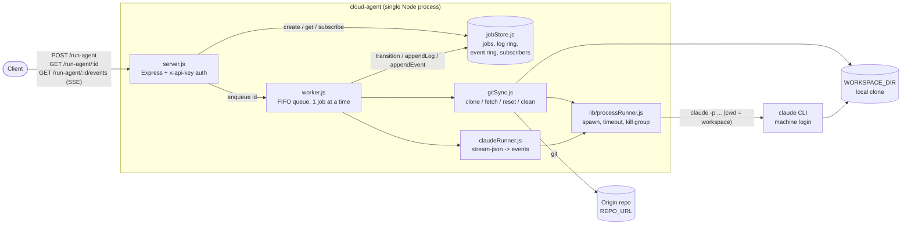
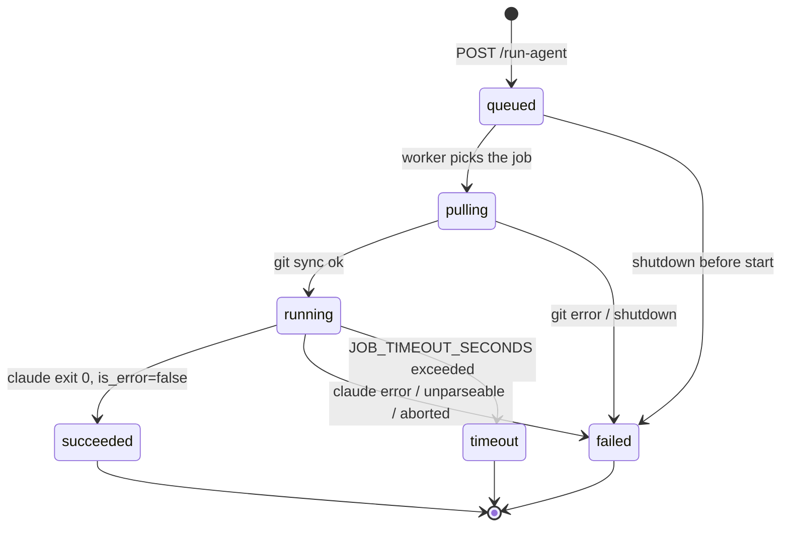

# Architecture

`cloud-agent` is a small Node/Express service. A caller submits a prompt; the service pulls the latest
commit of a target repo into a single workspace, runs `claude -p` headless inside it, and exposes the
job's status, result and live progress over HTTP.

Sequence diagrams: [diagram/sequence-diagram.md](diagram/sequence-diagram.md).

## Components

| Module | Responsibility |
|---|---|
| `src/index.js` | Load config, check Claude login, wire modules, listen, graceful shutdown. |
| `src/config.js` | Parse and validate env (`REPO_URL`, `REPO_BRANCH`, `WORKSPACE_DIR`, `API_KEY`, ...). |
| `src/server.js` | HTTP routes, `x-api-key` auth, SSE endpoint (`formatSse`, replay, heartbeat, `closeStreams`). |
| `src/jobStore.js` | In-memory jobs; the **only** code allowed to change status. Also holds the per-job log ring and event ring (default 2000) with subscribers. |
| `src/worker.js` | FIFO queue; runs exactly one job at a time against the single workspace. |
| `src/gitSync.js` | Bring the workspace to a pristine checkout of `origin/<branch>`; report the short commit. |
| `src/claudeRunner.js` | Run `claude -p --output-format stream-json --verbose`, map each NDJSON line to a live event (`toEvents`), classify the outcome. |
| `src/lib/processRunner.js` | The only place that spawns processes: timeout, abort, process-group kill, output capture. |
| `src/claudeAuth.js` | Startup check that the machine is logged in to a Claude subscription. |

## Job lifecycle

Every transition is recorded by `jobStore.transition`, which also emits a `status` event; entering a
terminal state additionally emits the terminal `result` event.

## Request flow

1. **Submit.** `POST /run-agent` validates the body, creates a `queued` job, enqueues its id and returns
   `202 {id, status}` immediately (it never waits for the run).
2. **Pull.** The worker moves the job to `pulling`. `gitSync` clones on first use, then fetches
   `origin/<branch>` and does checkout / reset / clean so every run starts from a pristine tree.
3. **Run.** The job moves to `running`. `claudeRunner` spawns `claude -p` with the prompt on stdin and
   `cwd = WORKSPACE_DIR`, so the repo's own `.claude/` agents, skills and commands apply.
4. **Stream.** Each stdout line of the stream-json output becomes a live event
   (`init`, `thinking`, `assistant_text`, `tool_use`, `tool_result`) appended to the job's event ring;
   git/stderr lines become `log` events.
5. **Finish.** The final `result` line decides the outcome (`succeeded` / `failed` / `timeout`). The
   store emits the terminal `result` event and SSE streams close.
6. **Observe.** Clients either poll `GET /run-agent/:id` (status, result, `logs_tail`) or subscribe to
   `GET /run-agent/:id/events` for live progress.

## Live progress (SSE)

- **Replay + live:** the handler subscribes first, then replays buffered events with `seq >
  Last-Event-ID` (both synchronous, so nothing slips between them). If older events were evicted it
  sends a `gap {dropped}` event first.
- **Termination:** the stream ends right after the `result` event; a finished job replays and closes.
- **Safety:** `: ping` heartbeat every 15 s, slow readers are dropped (they resume via
  `Last-Event-ID`), `X-Accel-Buffering: no` for proxies, `app.closeStreams()` on shutdown.
- **Auth:** same `x-api-key` header as the other routes, so browsers must use `fetch()` with a streaming
  reader rather than `EventSource`.

## Key design decisions

| Decision | Reason |
|---|---|
| One job at a time, one workspace | Two jobs pulling/running in the same folder would interfere. Scale-out = a worktree/clone per job. |
| `claude` runs in its own process group | A timeout or shutdown kills the whole tree (bash tools, test runners, subagents). |
| Subscription login, not API key | `ANTHROPIC_API_KEY` / OAuth env vars are stripped from the child env so the machine login is always used. |
| Prompt on stdin | Avoids argv limits and prompts starting with `-` being parsed as flags. |
| In-memory state | PoC scope. A restart loses jobs and events; persistence is future work. |
| Result taken from the stream | The `result` line is captured while streaming, so the 10 MB capture cap can't lose it. |

## Configuration

See `.env.example`. Relevant to this flow: `REPO_URL`, `REPO_BRANCH`, `WORKSPACE_DIR`,
`GIT_SSH_KEY_PATH` / `GIT_TOKEN`, `CLAUDE_PERMISSION_MODE`, `CLAUDE_MAX_TURNS`, `JOB_TIMEOUT_SECONDS`,
`PORT`, `API_KEY`.
