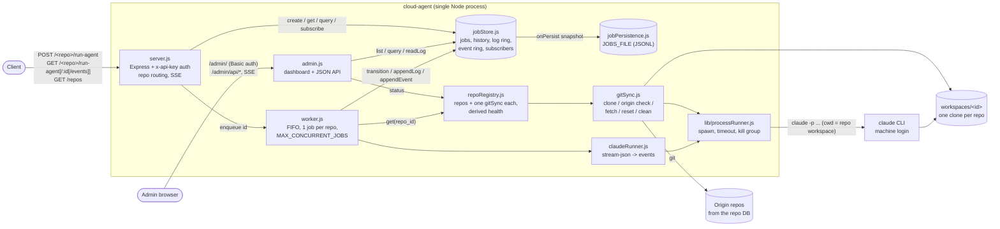
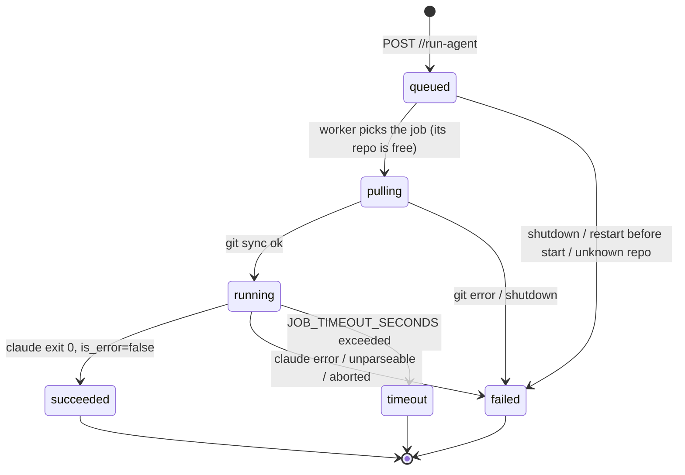
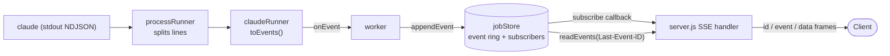

# Architecture

`cloud-agent` is a small Node/Express service. A caller submits a prompt for one of the configured repos;
the service pulls the latest commit of that repo into the repo's own workspace, runs `claude -p` headless
inside it, and exposes the job's status, result and live progress over HTTP. A read-only admin dashboard
shows every repo's health and jobs.

Sequence diagrams: [diagram/sequence-diagram.md](diagram/sequence-diagram.md).

## Components

| Module | Responsibility |
|---|---|
| `src/index.js` | Load config, check Claude login, load the jobs file, wire modules, listen, graceful shutdown. |
| `src/config.js` | Parse and validate env (fail fast; retired repos.json-era vars rejected). |
| `src/repoRegistry.js` | The configured repos, one `gitSync` each; repo health/status derived from job history. |
| `src/server.js` | API routes (`/repos`, `/<repo>/run-agent...`), `x-api-key` auth, `createSseHandler` (shared with admin), `closeStreams`. |
| `src/admin.js` + `web/` | Read-only dashboard (React + Ant Design app built into `web/dist`) and its JSON API, behind HTTP Basic auth. |
| `src/jobStore.js` | In-memory jobs; the **only** code allowed to change status. Status history, listing/paging, retention, per-job log ring and event ring with subscribers, snapshot/hydrate for persistence. |
| `src/jobPersistence.js` | Optional append-only JSONL of job snapshots (`JOBS_FILE`), compacted atomically. |
| `src/worker.js` | Scheduler: global FIFO, at most one job per repo, at most `MAX_CONCURRENT_JOBS` overall. |
| `src/gitSync.js` | Bring a repo's workspace to a pristine checkout of `origin/<branch>`; refuse a workspace cloned from another repo; report the short commit. |
| `src/claudeRunner.js` | Run `claude -p --output-format stream-json --verbose`, map each NDJSON line to a live event (`toEvents`), classify the outcome. |
| `src/lib/processRunner.js` | The only place that spawns processes: timeout, abort, process-group kill, output capture. |
| `src/claudeAuth.js` | Startup check that the machine is logged in to a Claude subscription. |

## Job lifecycle

Every transition is recorded by `jobStore.transition`, which appends to the job's `history`, emits a
`status` event and (with `JOBS_FILE`) persists a snapshot; entering a terminal state additionally emits the
terminal `result` event. Jobs that were not finished when the process died are loaded back as `failed`.

## Request flow

1. **Submit.** `POST /<repo>/run-agent` checks the API key, then that `<repo>` is configured (else 404),
   validates the body, creates a `queued` job with `repo_id` and the branch (default: the repo's
   `defaultBranch`), enqueues its id and returns `202 {id, status}` immediately (it never waits for the run).
2. **Schedule.** The worker walks its FIFO and starts every job whose repo is not busy, up to
   `MAX_CONCURRENT_JOBS`. A job behind a busy repo keeps its place; other repos' jobs go ahead of it.
3. **Pull.** The job moves to `pulling`. The repo's `gitSync` clones on first use (otherwise checks that the
   workspace's `origin` is this repo), then fetches `origin/<branch>` and does checkout / reset / clean so
   every run starts from a pristine tree.
4. **Run.** The job moves to `running`. `claudeRunner` spawns `claude -p` with the prompt on stdin and
   `cwd = workspaces/<repo>`, so the repo's own `.claude/` agents, skills and commands apply.
5. **Stream.** Each stdout line of the stream-json output becomes a live event
   (`init`, `thinking`, `assistant_text`, `tool_use`, `tool_result`) appended to the job's event ring;
   git/stderr lines become `log` events.
6. **Finish.** The final `result` line decides the outcome (`succeeded` / `failed` / `timeout`). The
   store emits the terminal `result` event and SSE streams close.
7. **Observe.** Clients either poll `GET /<repo>/run-agent/:id` (status, result, `logs_tail`) or subscribe to
   `GET /<repo>/run-agent/:id/events` for live progress. Admins use the dashboard.

## Live progress (SSE)

- **Replay + live:** the handler subscribes first, then replays buffered events with `seq >
  Last-Event-ID` (both synchronous, so nothing slips between them). If older events were evicted it
  sends a `gap {dropped}` event first.
- **Termination:** the stream ends right after the `result` event; a finished job replays and closes.
- **Safety:** `: ping` heartbeat every 15 s, slow readers are dropped (they resume via
  `Last-Event-ID`), `X-Accel-Buffering: no` for proxies, `app.closeStreams()` on shutdown.
- **Auth:** the API stream uses the same `x-api-key` header as the other routes, so browsers must use
  `fetch()` with a streaming reader. The dashboard's copy (`/admin/api/jobs/:id/events`, same handler) is
  behind Basic auth, which browsers resend automatically, so it uses plain `EventSource`.

## Admin dashboard

- React + Ant Design single-page app in `web/` (Vite, TanStack Query, react-router), built into `web/dist` by
  `npm run build:web` and served by Express: hashed `/admin/assets/*` cached for a year, `index.html` never cached,
  and every other extension-less `GET /admin/*` falls back to `index.html` for client-side routing. Without a
  build, pages answer 503. Lists poll every 5 s; job detail uses SSE (`web/src/hooks/useJobEvents.ts`).
- All job text (prompts, logs, tool output, results) is untrusted and rendered through React's escaping only;
  `dangerouslySetInnerHTML` is banned (a test scans `web/src`).
- CSP allows `style-src 'unsafe-inline'` because antd injects its styles at runtime; scripts stay `'self'` only.
- Repo health is derived, not stored: the newest job that entered `pulling` decides it (`running` next =
  `ok`, `failed` next = `sync_error`, still pulling = `syncing`, none = `never_synced`).
- Not mounted unless `ADMIN_PASSWORD` is set. Read-only; CSP `default-src 'self'`, `frame-ancestors 'none'`,
  `Cache-Control: no-store` on the API.

## Key design decisions

| Decision | Reason |
|---|---|
| One clone per repo, one job per repo at a time | Two jobs in the same folder would interfere. Different repos are independent, so they may run in parallel (`MAX_CONCURRENT_JOBS`, default 1). Parallel jobs on the same repo would need a worktree per job (future work). |
| Repos come from a file, not an API | Repo URLs stay operator input (git URLs like `ext::` can run commands), secrets never travel over HTTP, and no repo can disappear while a job runs on it. |
| A credential per repo, no shared fallback | A shared token would be sent to every repo's host. Tokens are referenced by env-var name and scoped to the repo's own origin; `GIT_ALLOW_PROTOCOL=https:ssh:file`. |
| Repo in the URL path | Every request says which repo it targets; a job is only visible under its own repo. |
| Basic auth for the dashboard | Separate secret from `API_KEY`; the browser prompts and resends it (also for `EventSource`), so no login page or sessions. |
| `claude` runs in its own process group | A timeout or shutdown kills the whole tree (bash tools, test runners, subagents). |
| Subscription login, not API key | `ANTHROPIC_API_KEY` / OAuth env vars are stripped from the child env so the machine login is always used. |
| Prompt on stdin | Avoids argv limits and prompts starting with `-` being parsed as flags. |
| JSONL job file, no database | No dependency, works on Node 18; filtering happens in memory (fine for thousands of jobs). Live events are not persisted. |
| Result taken from the stream | The `result` line is captured while streaming, so the 10 MB capture cap can't lose it. |

## Configuration

See `.env.example`. Repos and their encrypted tokens live in `DB_FILE` (admin API/dashboard, or
`node src/cli.js import`); `MASTER_KEY`, `WORKSPACE_ROOT`, `SSH_KEYS_DIR`, `ALLOW_LOCAL_REPOS`,
`MAX_CONCURRENT_JOBS`, `JOBS_FILE`, `JOB_RETENTION_MAX`, `ADMIN_USER` / `ADMIN_PASSWORD`,
`CLAUDE_PERMISSION_MODE`, `CLAUDE_MAX_TURNS`, `JOB_TIMEOUT_SECONDS`, `PORT`, `API_KEY`.
