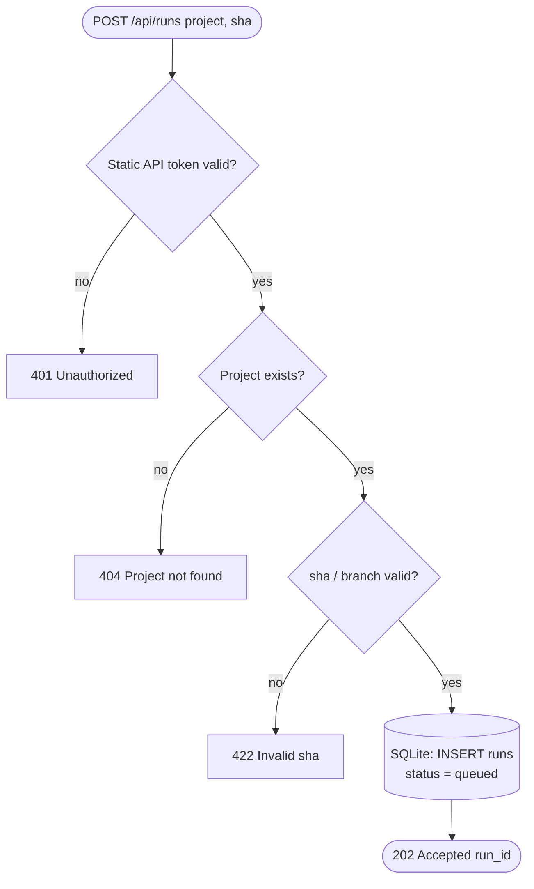
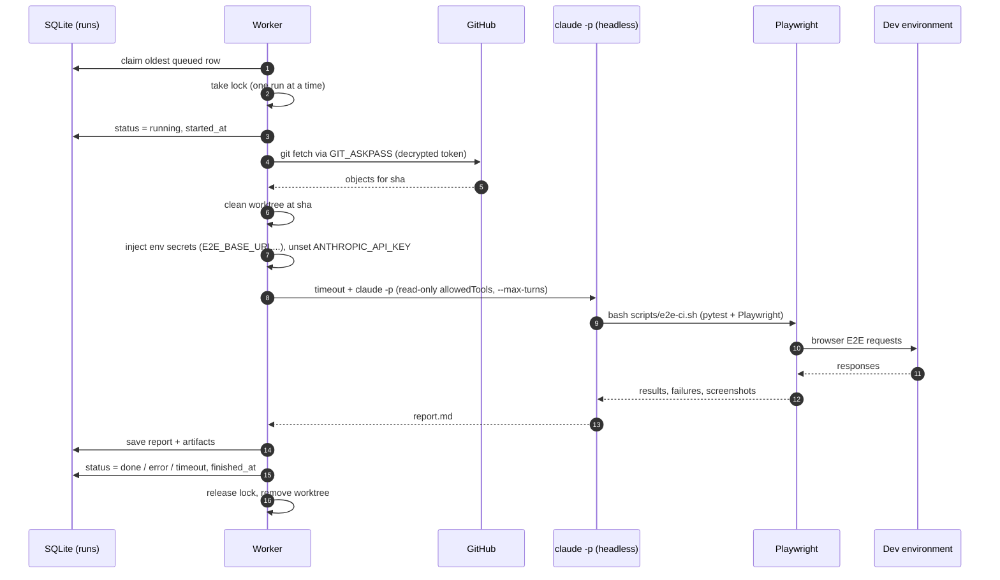
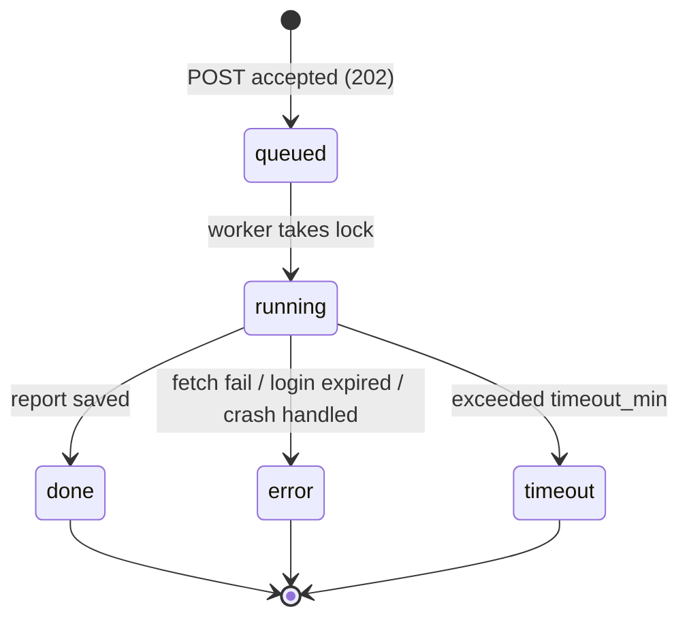

# Flow 1 — VPS receives a request

Source: [cloud-test-agent-architecture.md](../cloud-test-agent-architecture.md) §3, §6, §7, §8.
Diagrams use Mermaid (render on GitHub / most Markdown viewers).

## 1a. API request: `POST /api/runs`

## 1b. Worker: from queued row to final status

### Failure points

| Failure | Where it appears | Resulting status |
|---|---|---|
| Git fetch fails (bad token, missing sha) | step 4 | `error` |
| Claude login expired | `claude -p` start | `error: claude login expired` |
| Run exceeds `timeout_min` | `claude -p` | `timeout` |
| `--max-turns` reached | `claude -p` | undefined in doc (see gaps) |
| Dev unreachable | Playwright | undefined in doc (see gaps) |
| Worker crash | any step after claim | stuck in `running` (no recovery in doc) |

## 1c. Run state machine

Rejected requests (401 / 404 / 422) never create a row.

## Gaps in the source doc

- `POST /api/runs` validation and error codes are not defined; a retried POST can queue the same SHA twice.
- If the worker fetches by branch, a later force-push of `agent/test` can make an older queued SHA unfetchable.
- Unclear whether "dev unreachable" or `--max-turns` ends as `done` (FAIL report) or `error`.
- No recovery for runs stuck in `running` after a worker crash; no cancel.
