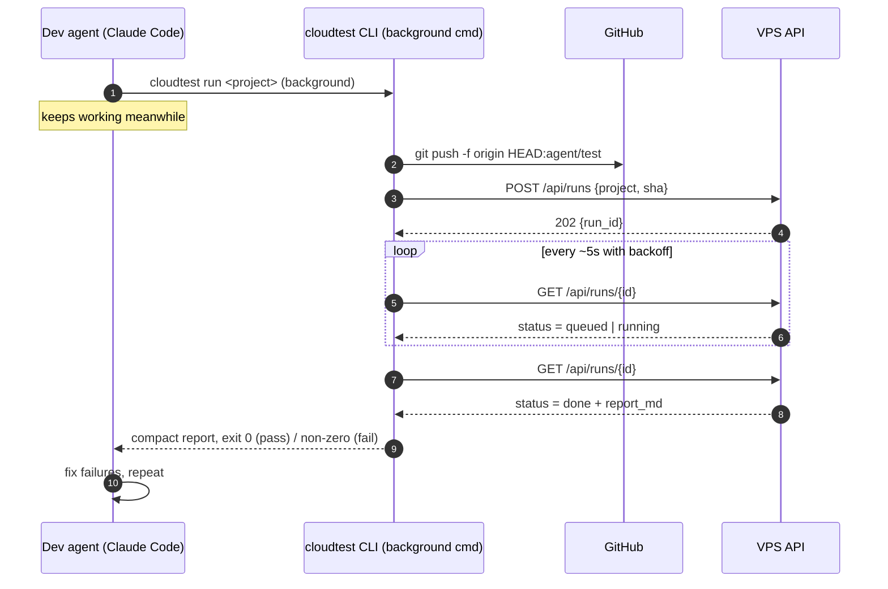
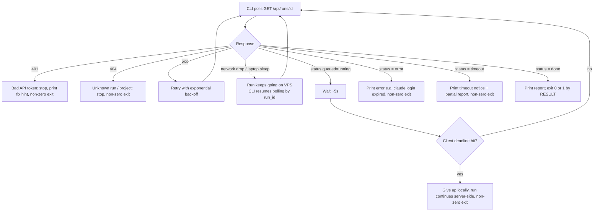
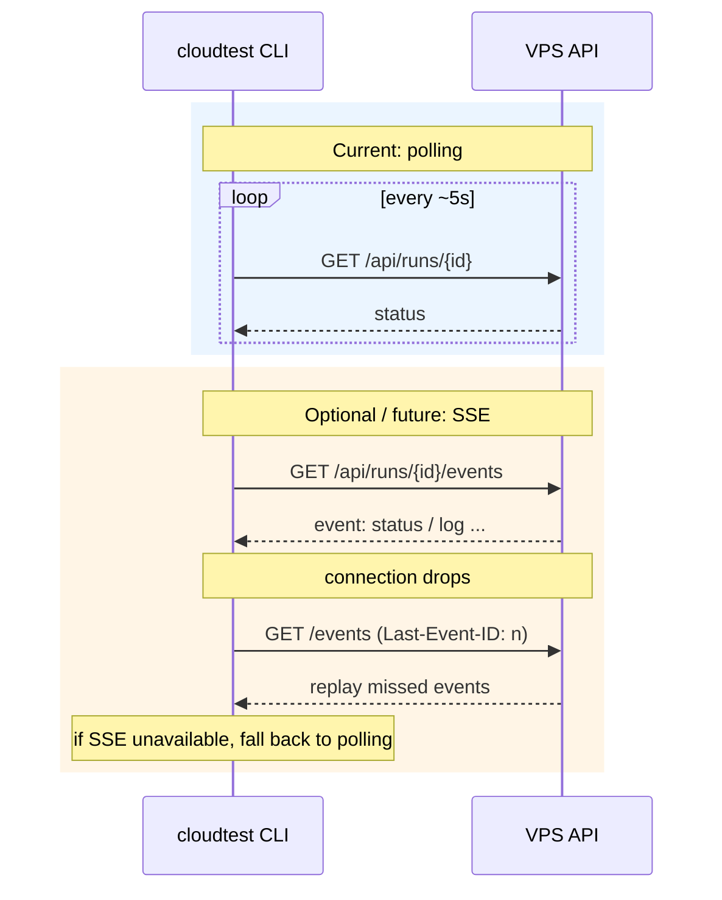

# Flow 2 — Client Claude sends a run and receives result / errors

Source: [cloud-test-agent-architecture.md](../cloud-test-agent-architecture.md) §3, §6, §10.
Diagrams use Mermaid (render on GitHub / most Markdown viewers).

## 2a. Normal run (polling)

## 2b. Error paths

Exit codes 2–5 for the distinct error classes are a suggestion; the source doc only says "non-zero on fail".

## 2c. Polling vs SSE

SSE is **not** part of the current design (cut in §10). Shown for comparison only.

## Gaps in the source doc

- Backoff limits and the CLI's overall deadline are not specified.
- Exit code meanings are not defined.
- Response shape of `GET /api/runs/{id}` (report, artifact links) is not defined.
- Where `run_id` is stored so a restarted CLI can resume is not defined.
