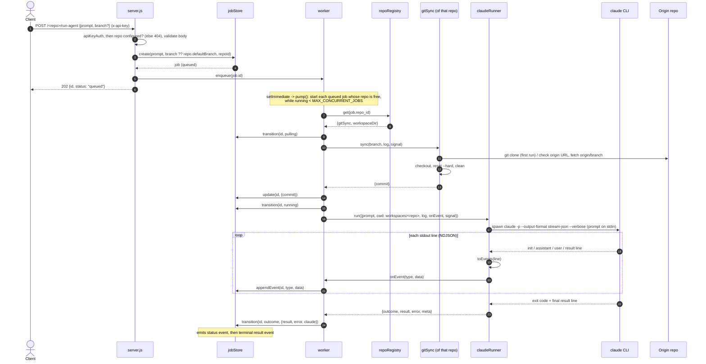
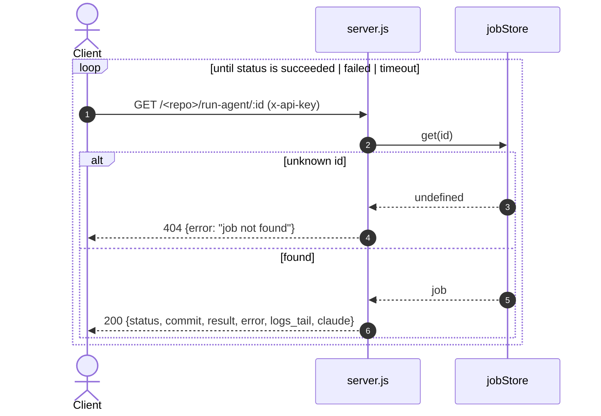
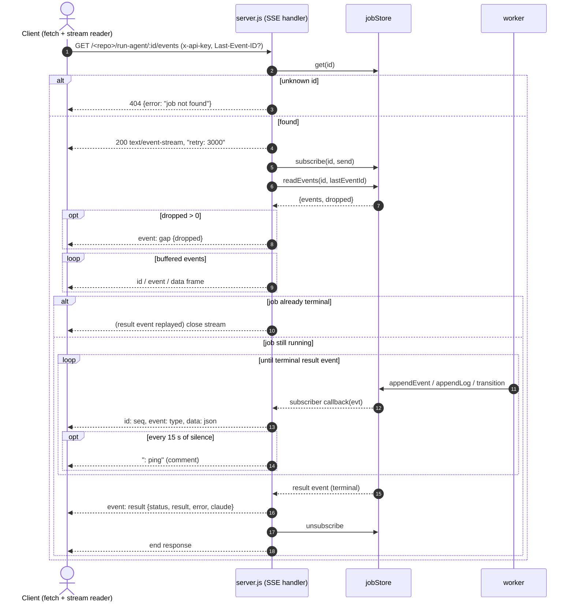
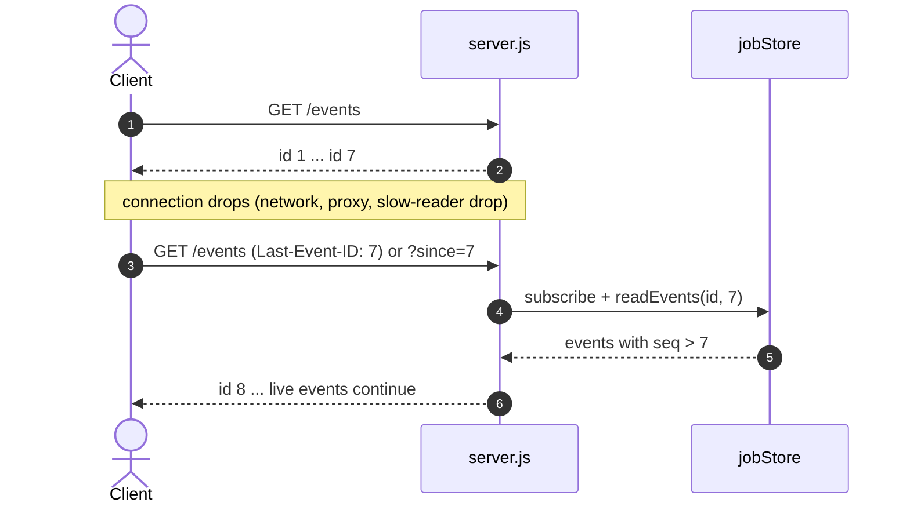
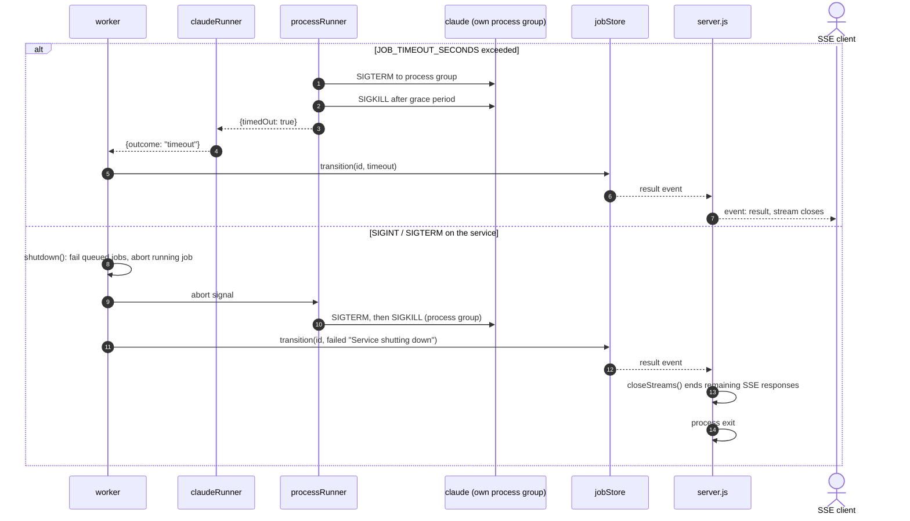
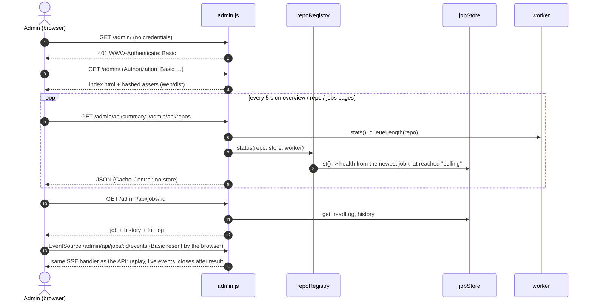

# Sequence diagrams

Diagrams use [Mermaid](https://mermaid.js.org/) (rendered natively by GitHub and most Markdown viewers).
Overview: [../ARCHITECTURE.md](../ARCHITECTURE.md).

## 1. Submit a job and run it

## 2. Poll for status

## 3. Live progress over SSE

## 4. Reconnect and resume

## 5. Timeout and graceful shutdown

## Admin dashboard

